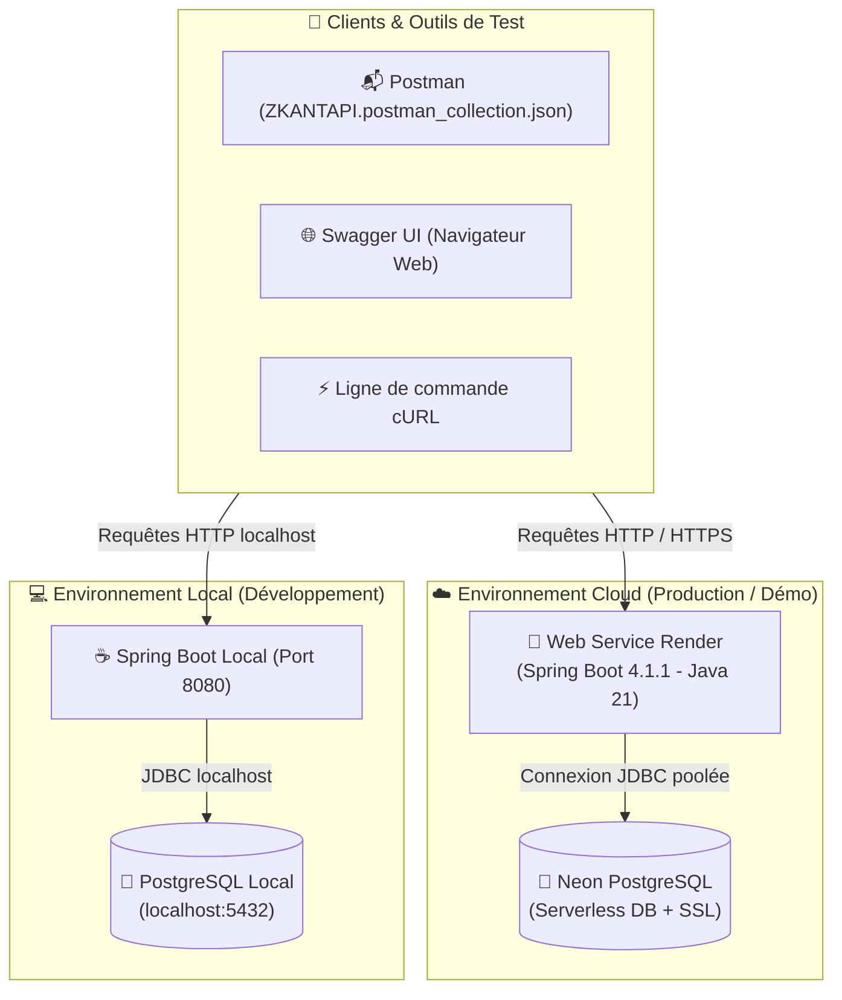

# 🎓 Suivi Scolaire API — Plateforme de Gestion Académique

<p align="center">
  
  
  
  
  
  
  
  
</p>

---

## 📖 Sommaire
1. [🌟 Présentation du Projet](#-présentation-du-projet)
2. [🌐 Accès & Documentation Interactive (Swagger)](#-accès--documentation-interactive-swagger)
3. [🏗️ Architecture Globale & Déploiement](#️-architecture-globale--déploiement)
4. [🗄️ Gestion des Bases de Données & Flyway](#️-gestion-des-bases-de-données--flyway)
5. [📬 Collection Postman (Pièce Jointe)](#-collection-postman-pièce-jointe)
6. [⚡ Exemples de Commandes cURL (En Ligne & Local)](#-exemples-de-commandes-curl-en-ligne--local)
7. [💻 Guide de Démarrage en Local](#-guide-de-démarrage-en-local)
8. [📁 Organisation des Tests & Bonnes Pratiques](#-organisation-des-tests--bonnes-pratiques)

---

## 🌟 Présentation du Projet

L'API **Suivi Scolaire** est une solution backend robuste conçue pour administrer l'intégralité du cycle de vie d'un établissement d'enseignement secondaire ou supérieur. 

### 🎯 Fonctionnalités clés :
* **Gestion des structures académiques** : Niveaux, classes, matières, coefficients et affectation des professeurs.
* **Gestion des élèves & inscriptions** : Matricules uniques, dossiers d'inscriptions, aménagements spécifiques.
* **Évaluations & Notes** : Périodes trimestrielles, types d'évaluations, barèmes et coefficients.
* **Règles métier avancées** : Clôture/réouverture sécurisée des trimestres, calcul dynamique des moyennes pondérées, détection des élèves siglés.
* **Restitution & Décision** : Bulletins de notes trimestriels, statistiques et comparatifs de moyennes.

---

## 🌐 Accès & Documentation Interactive (Swagger)

L'API est hébergée sur le cloud **Render** et reliée à une base de données managée **Neon PostgreSQL**, tout en étant 100% exécutable en local sur votre poste.

| Composant | Environnement Cloud (En Ligne) | Environnement Local |
| :--- | :--- | :--- |
| **Hôte / Plateforme** | **Render Cloud** | **Machine Locale** |
| **URL Racine API** | [`https://suivi-scolaire-t62q.onrender.com`](https://suivi-scolaire-t62q.onrender.com) | `http://localhost:8080` |
| **Swagger UI Interactive** | [👉 Consulter Swagger en ligne](https://suivi-scolaire-t62q.onrender.com/swagger-ui/index.html) | [👉 Consulter Swagger en local](http://localhost:8080/swagger-ui/index.html) |
| **Exemple direct (Classes)** | [`Swagger - Classes/getAll_4`](https://suivi-scolaire-t62q.onrender.com/swagger-ui/index.html#/Classes/getAll_4) | `http://localhost:8080/swagger-ui/index.html#/Classes` |
| **Spécification OpenAPI JSON** | [`/v3/api-docs`](https://suivi-scolaire-t62q.onrender.com/v3/api-docs) | `http://localhost:8080/v3/api-docs` |

> [!TIP]
> Vous pouvez tester n'importe quel endpoint directement depuis votre navigateur avec l'interface Swagger UI grâce au bouton **"Try it out"**.

---

## 🏗️ Architecture Globale & Déploiement



---

## 🗄️ Gestion des Bases de Données & Flyway

Le projet applique les principes de **Database-as-Code** grâce à **Flyway**. Que vous vous connectiez à la base en ligne Neon ou que vous cloniez le dépôt pour la première fois en local, **aucune intervention manuelle n'est requise** : la base est automatiquement créée et pré-remplie au démarrage de l'application !

### 1. Deux environnements de données synchronisés
* **Base de données en ligne** : Hébergée sur **Neon**, sécurisée par SSL.
* **Base de données locale** : PostgreSQL local (`suivi_scolaire`).

### 2. Migrations Flyway automatisées
* 📜 **`V1.0.1__DDL.sql`** :
  * Nettoyage préalable dynamique des tables et vues obsolètes.
  * Création ordonnée de la structure complète (**19 tables relationnelles** : `annee`, `niveau`, `classe`, `matiere`, `professeur`, `eleve`, `periode`, `type_evaluation`, `coefficient`, `inscription`, `enseignement`, `note`, `salle`, `creneaux`, `cours`, `absence`, `bulettin`, `moyenne_matieres`, `amenagement`).
  * Mise en place des index de recherche optimisés (`matricule`, `nom`, `prenom`, etc.).
* 📊 **`V1.0.2__DML.sql`** :
  * Injection du jeu de données de test complet (élèves répertoriés de `ELV-1` à `ELV-78`, classes de 6ème à Terminale, matières et professeurs, coefficients, notes de trimestres).
  * Réalignement automatique des séquences `IDENTITY` (`setval`) pour garantir des créations d'entités sans conflit de clé primaire via l'API.

---

## 📬 Collection Postman (Pièce Jointe : `postman.json`)

Pour permettre une recette rapide et exhaustive sans ressaisir les URLs ni les payloads JSON, la collection Postman complète et prête à l'emploi est directement fournie en pièce jointe à la racine du projet sous le nom :

📦 **[`postman.json`](file:///home/yokan/TAF/FORMATION/TESTO/suiviScolaire/postman.json)** *(également disponible sous `ZKANTAPI.postman_collection.json`)*

### 🚀 Guide d'importation dans Postman :
1. **Ouvrir Postman** et cliquer sur **Import** en haut à gauche.
2. Sélectionner ou glisser-déposer le fichier [`postman.json`](file:///home/yokan/TAF/FORMATION/TESTO/suiviScolaire/postman.json) (ou `ZKANTAPI.postman_collection.json`).
3. **Bascule en un clic :** Modifier la variable `baseUrl` de la collection :
   * Pour tester **En Ligne** : `https://suivi-scolaire-t62q.onrender.com`
   * Pour tester **En Local** : `http://localhost:8080`

### 📋 Structure de la Collection :
* **Niveau 1 — CRUD de Base** : Gestion des classes, élèves, professeurs, matières et types d'évaluation.
* **Niveau 2 — Recherches & Consultations** : Filtres paginés, emplois du temps, suivi des absences par période.
* **Niveau 3 — Règles Métier Avancées** : Clôture/réouverture des trimestres avec motifs, alertes de décrochage scolaire, élèves siglés.
* **Niveau 4 — Restitution & Décision** : Calcul des moyennes pondérées, génération des bulletins officiels et classements.

---

## ⚡ Exemples de Commandes cURL (En Ligne & Local)

Vous pouvez copier/coller ces commandes directement dans votre terminal pour tester instantanément.

### 1. Consulter la liste des classes
```bash
# 🌐 En Ligne (Render)
curl -X GET "https://suivi-scolaire-t62q.onrender.com/classes" -H "Accept: application/json"

# 💻 En Local
curl -X GET "http://localhost:8080/classes" -H "Accept: application/json"
```

### 2. Consulter la fiche d'un élève (ex: ID 1)
```bash
# 🌐 En Ligne (Render)
curl -X GET "https://suivi-scolaire-t62q.onrender.com/eleves/1" -H "Accept: application/json"

# 💻 En Local
curl -X GET "http://localhost:8080/eleves/1" -H "Accept: application/json"
```

### 3. Consulter les matières et coefficients
```bash
curl -X GET "https://suivi-scolaire-t62q.onrender.com/matieres" -H "Accept: application/json"
```

### 4. Consulter les bulletins trimestriels
```bash
curl -X GET "https://suivi-scolaire-t62q.onrender.com/eleves/1/bulletin" -H "Accept: application/json"
```

---

## 💻 Guide de Démarrage en Local

### 1. Cloner le projet
```bash
git clone git@github.com:kanteyouss/Suivi-Scolaire.git
cd Suivi-Scolaire
git checkout KANTAPI-N4-F001
```

### 2. Prérequis
* **JDK 21** installé (`java -version`)
* **PostgreSQL** démarré avec une base `suivi_scolaire` créée :
```sql
CREATE DATABASE suivi_scolaire;
```

### 3. Lancer l'application
```bash
./mvnw clean spring-boot:run
```

Au démarrage :
1. Flyway migre le schéma et insère les 500+ lignes de test en moins d'une seconde.
2. L'application démarre sur le port `8080`.
3. Rendez-vous sur `http://localhost:8080/swagger-ui/index.html` !

---

## 📁 Organisation des Tests & Bonnes Pratiques

Pour respecter les standards de propreté logicielle et d'intégration continue :
* 📂 **Dossier `test-docs/`** : Tous les scripts bash de simulation (`test_niveau1.sh`, `test_niveau2_3_4.sh`) ainsi que les fiches détaillées de tests Markdown (`Tests_CURL_*.md`, `DTO_ANALYSIS.md`) ont été regroupés dans ce sous-dossier dédié.
* 🛡️ **`.gitignore`** : Le dossier `test-docs/` est explicitement ignoré afin de maintenir un dépôt Git propre et focalisé sur le code applicatif, la documentation principale et la collection Postman.
* 📦 **Collection Postman** : [`postman.json`](file:///home/yokan/TAF/FORMATION/TESTO/suiviScolaire/postman.json) *(et `ZKANTAPI.postman_collection.json`)* reste versionnée à la racine pour un partage immédiat avec toute personne évaluant ou intégrant l'API.

---

<p align="center">
  <b>Développé & Déployé avec excellence — API Suivi Scolaire</b>
</p>
